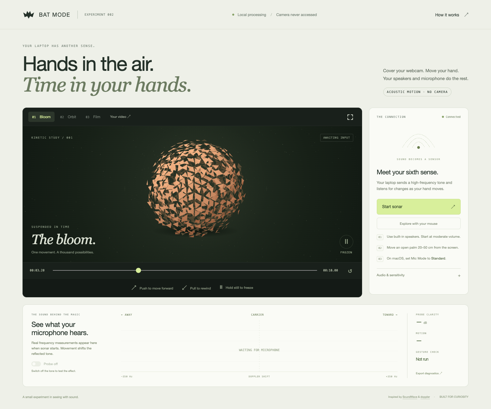

# Bat Mode

Cover your webcam. Move your hand. Move through time.

A local experiment that uses a laptop's speakers and microphone to sense motion
through Doppler-shifted sound. Push toward the laptop to advance a scene, pull away
to rewind, and hold still to freeze it. No camera, account, API key, or audio upload.



Experimental, Mac-first release. The creator has tested the demo locally; results
on other hardware may vary. Python performs the sensing and serves the browser UI.

## Start

With [uv](https://docs.astral.sh/uv/getting-started/installation/) and Git installed:

```sh
uvx --from "git+https://github.com/josharsh/bat-mode@v0.1.0" bat-mode
```

Or clone the repository and run the included launcher:

```sh
git clone https://github.com/josharsh/bat-mode.git
cd bat-mode
./launch.sh
```

On macOS, you can also download and extract the source ZIP from
[Releases](https://github.com/josharsh/bat-mode/releases), then double-click
**Bat Mode.command** inside the extracted folder. This is a Python application
with a local browser interface, not a self-contained native macOS app.

The launcher installs the small Python environment on the first run and opens
**http://127.0.0.1:8765**. It prefers [uv](https://docs.astral.sh/uv/); otherwise it
uses Python 3.10+ and a local virtual environment. Subsequent runs use that environment.
No Node.js, build step, ffmpeg, or model download is needed to run the demo.

Microphone access is requested by the Python/Terminal process, **not the webpage**.
On macOS, allow the app launching Python in System Settings → Privacy & Security →
Microphone if needed. Select the MacBook microphone and speakers in Audio & sensitivity.

## Your first demo

1. Use the built-in speakers and microphone. Disconnect headphones and start with
   moderate system volume. Set macOS Control Center → Mic Mode to **Standard**.
2. Cover the webcam, keeping microphones unobstructed. Click **Start sonar**.
3. Hold still while the app selects a tone and learns the room (about five seconds).
4. Move an open palm toward the screen from roughly 20–50 cm away, then pull it back
   when prompted. These are actual motion checks; the app does not assume success.
5. Push/pull to scrub the copper **Bloom**, switch to **Orbit**, or choose **Film**
   for the bundled six-second clip. Hold still to stop time.
6. Switch **Probe off**. The microphone spectrum remains live, while time control
   stops. Switch it back on to continue.

Use **Your video** or drag a local video onto the scene. It stays in the browser.
Short H.264 MP4 files with frequent keyframes give the smoothest backward seeking.
The bundled original film has a keyframe at every frame.

**Explore with your mouse** is a separate, explicitly labeled preview. Drag across
the scene or focus it and use the arrow keys. Preview stops sonar and never draws
fake acoustic measurements. The timeline is also usable with the mouse when sonar
is stopped. The fullscreen button enlarges the scene for presenting.

Click **Stop sonar** to release the microphone and silence the speakers. Hiding the
tab also stops sonar. Closing the page sends a stop command; an eight-second
heartbeat timeout is the fallback if the browser disappears. Ctrl+C in the terminal
stops both the server and audio. The server listens only on loopback.

## If it needs tuning

| Symptom | Try |
| --- | --- |
| No clear probe / weak signal | Check built-in audio devices, mute state, and system volume. Avoid Bluetooth output and Voice Isolation. |
| Push/pull check does not finish | Make a deliberate palm movement near the speakers. Lower Motion threshold from 8 dB to 6 dB and retry. |
| Movement while you are still | Increase Motion threshold, keep the laptop stationary, and recalibrate while the room is quiet. |
| Motion is right but scrubbing is slow | Increase Scrub speed. This changes the interaction, not detector sensitivity. |
| Tone is uncomfortable | Stop. Lower Probe level before restarting. High frequencies are audible to some people. |
| Another program owns the microphone | Close that program, select the device again, and restart sonar. |
| Port 8765 is busy | Run `./launch.sh --port 8766`. |
| Linux cannot load PortAudio | Install the system PortAudio library, then rerun the launcher. Linux/Windows sensing has not been validated. |

You can **Skip gesture check**, but the interface will show **Unverified**. A clear
carrier proves that speakers and microphone communicate; it does not prove reliable
hand sensing. This detects motion, not the identity, outline, or absolute position
of a hand. Other nearby motion can affect it.

## What is implemented

- Explicit start/stop, audio device selection, and gradual tone amplitude changes.
- 48 kHz duplex audio; a four-frequency search between 18.375 and 19.5 kHz.
- 8192-sample Blackman–Harris spectra, updated with fresh 1024-sample audio blocks.
- Per-bin quiet calibration, directional sideband comparison, and continuous
  smoothed motion output with a neutral state. No one-second gesture cooldown.
- Signal loss and clipping suppress time control. Missing browser updates also
  freeze playback. No raw audio is written to disk.
- Two deterministic, reversible canvas scenes; an original local MP4; local video
  loading; spectrum display; probe-off comparison; fullscreen and keyboard preview.
- Optional diagnostic download with a bounded window of derived spectra and motion
  readings. Downloads occur only when clicked; nothing is uploaded.

The UI runs entirely from local files served by Python. The Python audio engine
handles sensing; this release is **not a browser-only sonar implementation**.
The initial camera/microphone browser permissions policy disallows both APIs.

## Verification

```sh
uv run python -m unittest discover -s tests -v
```

21 automated tests cover synthesized acoustic signals (toward/away, stillness,
release, noise, clipping, probe-off and missing calibration) and local server
behavior. They do not establish real-world gesture accuracy.

Local verification on 2026-11-07:

- MacBook Pro built-in microphone/speakers opened successfully at 48 kHz.
- Automatic frequency and idle calibration completed; a 19.5 kHz probe was selected.
- The real audio stream reached the human push/pull check with no reported stream warnings.
- Chrome checks cover the mouse preview, scene switching, mobile layout, explanation
  dialog, forward/backward MP4 seeking, local video loading, live spectrum, explicit
  unverified calibration bypass, probe toggle, stop, and diagnostic download.
- The creator has tested the demo locally. Formal gesture accuracy measurements
  and performance across different laptops have not been established.

For a repeatable hand test, try 20 pushes, 20 pulls, and two minutes of stillness.
Count missed/wrong gestures and unintended motion. Recheck on another day before
claiming reliability or publishing compatibility results.

## Development

```sh
./launch.sh --no-open
```

`batmode/dsp.py` contains the pure signal processing, `audio.py` the hardware and
calibration state machine, and `server.py` the local HTTP interface. The UI lives in
`batmode/static/`. Reload the page after frontend edits; restart Python for backend
edits. This repository contains the standalone demo. Historical recordings and
the earlier multi-experiment workspace are not part of this distribution.

The original film is generated from `static/scene.js`. Optional regeneration needs
Chrome, Playwright (`npm install --no-save playwright`), and ffmpeg. With the local
server running, run `node tools/render-film.cjs`. These are development tools only.

## Research foundation

Inspired by [SoundWave: Using the Doppler Effect to Sense Gestures](https://www.microsoft.com/en-us/research/project/soundwave-using-the-doppler-effect-to-sense-gestures/)
(Gupta, Morris, Patel, and Tan, CHI 2012) and Daniel Rapp's
[doppler](https://github.com/DanielRapp/doppler) browser experiment. This implementation
builds on the sensing concept; it does not claim to invent acoustic gesture sensing
or reproduce the papers' evaluation results.

## License

[MIT](LICENSE). The original bundled film and canvas scenes are included under the
same license. Referenced research and third-party dependencies retain their own licenses.
